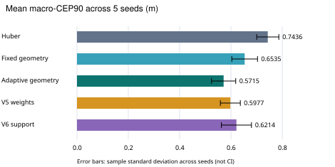
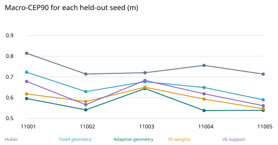

# 基于大语言模型智能体的众包鲁棒定位算法探索与实验验证

《人工智能与数学》课程项目：以二维静态测距定位为应用数学问题，保留 V1–V6 源程序、候选假设、工具实验与失败结果。**最终五种子实验中，自适应几何一致性基线最好；V5、V6 未超过该基线。**

本仓库整理自实际存在的 `my-math-agent` 文件，旧原型见 [robust-localization-agent](https://github.com/cicilem429-sys/robust-localization-agent)。旧仓库的三场景实验与本项目的四场景实验不同，不能混合比较。文件清单及原始 SHA-256 见 [来源清单](docs/source_manifest.json)。

## 数学问题与方法

给定节点坐标 $a_i\in\mathbb R^2$ 和距离观测 $d_i$，估计目标位置 $x$。残差为 $r_i(x)=\|x-a_i\|_2-d_i$，基础模型最小化 $\sum_i r_i(x)^2$。

- **Huber：** 以分段二次/线性损失抑制异常残差，最终基线取 $\delta=1$。
- **固定几何一致性：** 枚举三节点解析候选，选取残差阈值内节点最多的候选，再用一致节点做非线性最小二乘；阈值为 1.5。
- **自适应几何一致性：** 从 Huber 初始残差估计 $\hat\sigma=1.4826\operatorname{median}|r_i-\operatorname{median}(r)|$，取阈值 $\max(0.5,2\hat\sigma)$。
- **V5：** 固定几何初始解后，以高斯权重 $w_i=\exp[-\tfrac12(|r_i|/4)^2]$ 做加权 Huber，$\delta=1$。
- **V6：** 通过多个三节点候选对未参与构造该候选的节点投票，形成支持度与连续可信权重，再做加权 Huber。

以上是受限方法族中的实验探索，不能据此声称发现全新的数学理论或优于传统搜索的智能体。

## 实验结果

数据来自实际保存的 [JSON](final_validation_results.json) 与 [CSV](final_validation_summary.csv)。随机种子为 11001–11005；每种子 4 场景 × 3 噪声水平 × 10 次 = 120 组，共 600 组**合成观测**，每组含 10 个节点。所有方法在同一批观测上比较。

| 方法 | macro-CEP90 均值/m | 跨种子标准差/m | 平均定位误差/m |
|---|---:|---:|---:|
| Huber | 0.7436 | 0.0431 | 0.4875 |
| 固定几何一致性 | 0.6535 | 0.0501 | 0.4104 |
| 自适应几何一致性 | **0.5715** | 0.0472 | **0.3679** |
| V5 连续权重 | 0.5977 | 0.0389 | 0.3783 |
| V6 多候选支持度 | 0.6214 | 0.0586 | 0.3875 |





macro-CEP90 是 12 个“场景 × 噪声”子组各自经验 90% 分位误差的算术平均，不是混合样本的整体 CEP90。图中误差棒表示跨种子标准差，不是置信区间。

自适应几何在五批测试中均最好，相比 Huber 的平均 macro-CEP90 低约 23.1%。V5、V6 相对自适应方法的平均差值为 +0.0263、+0.0499 m。原程序的探索性配对 t 区间分别为约 [-0.0000, 0.0525] 与 [0.0132, 0.0867]；只有五个种子，不作普遍或严格显著性结论。

## 安装与离线复现

整理时读取的原实验环境为 Python 3.13、NumPy 2.5.5、SciPy 1.18.1、OpenAI SDK 3.57.0、python-dotenv 1.2.4，依赖固定于 `requirements.txt`。其他版本环境尚未验证。

```bash
python3 -m venv .venv
source .venv/bin/activate
python -m pip install -r requirements.txt
python final_statistical_validation.py --output-dir results/reproduced
python verify_delivery.py
```

Windows 激活命令：`.venv\Scripts\activate`。运行命令前进入仓库根目录。最终验证只调用本地数值计算，不需要密钥，也不会请求大模型；计算可能持续数分钟。原始根目录 JSON、CSV 保留，新运行默认写入 `results/reproduced/`，再次运行会覆盖该目录的同名文件。

`verify_delivery.py` 核验数据数量、保存指标、CSV 一致性、来源文件校验和及重跑结果（若存在）。跨平台优化器可能产生微小数值差异，不能将摘要核验等同于逐样本审计。

## 运行智能体

仅在希望重新开展付费模型探索时，在本机设置 `DEEPSEEK_API_KEY`，再运行相应版本：

```bash
python localization_agent.py
python localization_agent_v2.py
python research_agent_v3.py
python research_agent_v4.py
python research_agent_v5.py
python research_agent_v6.py
```

这些命令会调用 DeepSeek API、产生费用，并可能覆盖根目录的历史记录。V1–V4 多为脚本式结构，**不要通过 import 批量测试它们**。模型名称和价格常数是历史配置，不是当前服务可用性或账单保证；重跑前应自行检查服务配置。此轮整理没有调用付费模型。

## 文件与版本对应

| 阶段 | 程序 | 已保存记录 |
|---|---|---|
| V1 定位参数研究 | `localization_agent.py` | `localization_history.json`，4 次工具结果 |
| V2 策略比较 | `localization_agent_v2.py` | 同名 history，3 轮 |
| V3 多场景环境 | `research_agent_v3.py`、`research_environment_v3.py` | V3 history，3 轮 |
| V4 策略切换 | `research_agent_v4.py` | V4 history，4 轮 |
| V5 连续加权 | `research_agent_v5.py`、`weighted_localization.py` | V5 history，12 轮 |
| V6 几何支持度 | `research_agent_v6.py` | V6 history，16 轮 |
| 最终验证 | `final_statistical_validation.py` | `final_validation_results.json`、CSV |
| 数学工具 | `localization_tools.py`、`fast_geometry.py`、`adaptive_ten_anchor.py` 等 | 相关测试与辅助实验 |
| 早期回归练习 | `math_agent.py`、`research_agent.py`、`math_tools.py` | 不等同于定位 V1 |
| 报告与图表 | [最终研究报告](report/final_report.pdf)、`figures/` | 由保存结果生成 |

为保持原有导入可运行，源程序与历史文件保留在根目录，未强行移入 `src/`。`scripts/build_report.py` 可用 `requirements-report.txt` 的依赖重新生成报告和 SVG。生成报告不重新训练或修改算法结果。

## 本次整理的修复、缺失与局限

本次仅修复 V6 的 API 客户端延迟初始化，使离线验证无需密钥；为最终验证增加 `--output-dir`，避免覆盖原始结果。原始文件哈希及差异说明见 `docs/PROVENANCE.md`。

已找到 V1–V6 相关源码、最终 JSON/CSV、V2–V6 结构化实验历史；未找到独立的最终 PDF，当前报告是根据这些文件新编制的。V1 没有完整模型对话，其他版本保存的假设和实验摘要也不等同于完整逐条 API 请求/响应；未找到原始账单或真实设备数据。现有最终 JSON 保存聚合指标，未保存全部 600 组逐样本误差。上述材料不能伪造补齐。

本研究仅覆盖二维静态、直接测距、预定义异常扰动，不包含真实 BLE/RSSI 标定、移动目标、工业设备验证。`standard` 场景也包含一个 +8 m 异常值，并非干净场景。没有同等计算预算的全版本智能体对照，也没有证明大模型比传统搜索更有效。部分 BFGS 结果即便返回未成功收敛，只要数值有限仍参与评价；这是现有求解器实现的局限。

本仓库不含 `.env`、API 密钥、虚拟环境。AI 协助代码与报告整理，提交者应复现并理解方法、数据和结论。
